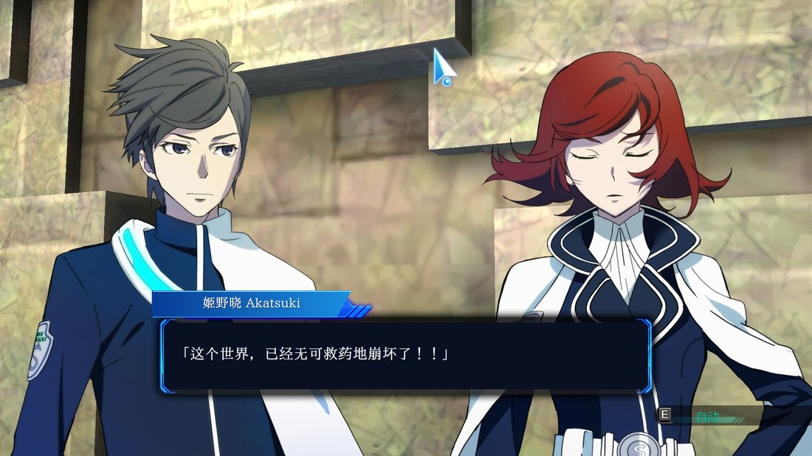

# Lost Dimension 简体中文汉化补丁

给 PC 版《Lost Dimension》（Steam AppID `626600`）做的简体中文补丁。

剧情对白全部中文化，**不改 exe、不注入 DLL、不联网**：对白由外挂浮层读游戏内存取原句、查表换成中文后画在屏幕上，游戏本体的数据文件只替换一个字库归档。



## ⚠️ 注意事项（先读）

- **只支持窗口模式。** 请在游戏里把画面设为窗口模式运行。全屏 / 无边框全屏下，浮层可能不显示、或与原生对白框对不齐——游戏本身不受影响，只是中文看不到。
- **只汉化了剧情部分。** 剧情对白、事件台词、说话人名字牌是中文；**系统菜单、道具 / 装备 / 出击列表、技能名、系统提示仍是官方英文**。原因见下文[「为什么对白不直接改写进游戏文本表」](#为什么对白不直接改写进游戏文本表)。

---

## 下载

发布物放在 [**Releases**](../../releases/latest)：`LostDimension_ZH_v1.0.zip`（约 42 MB，一键安装包）。

> 源码仓库不存放补丁文件，只放可构建的工程。普通玩家只需要 Releases 里的那个压缩包。

## 安装（3 步，约 30 秒）

1. 完全退出游戏。
2. 把压缩包解压到**游戏目录**，也就是和 `LostDimension.exe` 同一层：

   ```
   ...\steamapps\common\Lost Dimension\
   ```

   解压完会多出一个 `LostDimension_ZH_v1.0` 文件夹，进去双击 **`安装.bat`**。
   （多套一层目录没关系，安装器会自己往上找游戏根。）
3. 看到「安装完成」即可。以后从桌面或开始菜单的 **「Lost Dimension 汉化版」** 启动游戏。

### 卸载

双击 `卸载.bat`，会从备份还原 `Data.bra` 并删掉快捷方式；也可以直接在 Steam 里「验证游戏文件完整性」。卸载后整个 `LostDimension_ZH_v1.0` 文件夹可以直接删除，安装过程没有往系统里写任何东西。

---

## 它做了什么

| 部分 | 做法 | 备注 |
|---|---|---|
| 剧情 / 对白 | **外挂浮层** | 只读游戏进程内存取当前台词串 → 指纹查表（12,741 条）→ 用系统字体画中文面板，对齐并盖住原对白框 |
| 说话人 | **浮层名牌** | 从台词里的 `0x8096` 控制码解析说话人 ID，画出「姬野晓 Akatsuki」这样的中文名条 |
| 系统文本 | **`Data.bra` 差分补丁** | 2.05 MB 二进制差分，不含任何游戏原始资源 |
| `exe` / `ini` / 2D 贴图 | **不碰** | 所以不存在「改坏了启动不了」这类风险 |

浮层只做 `ReadProcessMemory`，不写游戏内存、不注入、不开网络连接；它随游戏启动、随游戏退出，不常驻、不开机自启。

---

## 为什么对白不直接改写进游戏文本表

游戏绘字用的是一张 **42 × 10 = 420 格** 的工作纹理，字符码位大于 420 会被引擎**直接丢弃**——不是显示成方块，而是整字消失。420 格已经被 ASCII 和现有 UI 文本占满，汉字塞不进去；而扩展这张纹理或改引擎都属于「改图 / 改 exe」，既侵入又容易崩。

所以这里走的是双层方案：**原生层保留官方英文，浮层用系统字体绘制完整中文并盖住对白框**。这样能上任意汉字、字号随分辨率自适应，也不必烘字形。

完整的技术细节、踩过的坑和数据结构，见 [`docs/汉化技术报告.md`](docs/汉化技术报告.md)。

---

## 已知限制

- **本补丁只覆盖剧情**。背包 / 装备 / 出击 / 道具列表、技能与敌人名、CONFIG 菜单，都保持官方英文，不提供中文。
- **列表类文本没法中文化**是上面那个 420 格限制导致的——汉字放进去会被丢弃，早期版本试过，整列变空白。
- **CONFIG 菜单的设置项名称、取值是英文**，因为它们烘焙在贴图里，属于「改图」范畴，本补丁不做。
- **只支持窗口模式**。全屏 / 无边框全屏下浮层可能不显示或对不齐。
- **从 Steam 库或直接双击 exe 启动不会带浮层**，必须走安装时创建的「Lost Dimension 汉化版」图标（它会先拉起浮层，再通过 Steam 启动游戏）。原因见下。
- **Steam 自动更新会覆盖 `Data.bra`**，汉化随之失效（游戏本身不会坏）。重新双击一次 `安装.bat` 即可。
- 浮层按画面里的蓝色竖向饰条配对来定位对白框，个别特殊构图的镜头会回落到固定比例，位置可能有轻微偏差。

## 关于杀软误报

`LDZH_Overlay.exe` 需要读取游戏进程内存才能拿到「当前是哪一句」，某些杀软会把「读别的进程内存」判为可疑。它**只读**，不写入、不注入、不联网，源码在 [`src/tools/`](src/tools/) 可自行审阅或自行编译。

## 关于「必须用专用图标启动」

Windows 没有「某进程一启动就执行另一个程序」这种内置触发器。能实现全覆盖的只有改注册表劫持、常驻 WMI 订阅、开启进程创建审核这几条路，代价都是常驻组件或系统级改动——为了一个补丁不值得。所以这里选了最轻的做法：一个启动器图标，先悄悄拉起浮层，再调 `steam://rungameid/626600`。

---

## 从源码构建

需要：Windows、Python 3.10+、正版游戏（生成差分补丁需要原版 `Data.bra`）。

```bash
pip install pillow bsdiff4 pylnk3 pyinstaller

# 直接跑浮层（调试用，需要 src/ps3map 下的数据与字体）
python src/tools/ld_overlay.py live

# 构建发布包 → src/publish/LostDimension_ZH_v1.0.zip
python src/tools/build_release.py
```

发布版浮层用 PyInstaller 打成单文件 exe，使用者无需安装 Python。构建脚本会做这几件事：把浮层和安装器各自打成 exe、复制运行期数据、重新生成差分补丁、写说明文档、打 zip。

`src/ps3map/fonts/` 下的字体不随仓库分发（体积 24 MB），可从 `dist/` 里的压缩包内 `LDZH/ps3map/fonts/` 取出，或自行放置任意中文字体——配置里的 `font.fallback` 会回落到系统微软雅黑 / 黑体。

## 目录结构

```
.
├── docs/
│   ├── 汉化技术报告.md          技术细节：归档格式、字库、浮层工作原理
│   └── images/
└── src/
    ├── tools/
    │   ├── ld_overlay.py       浮层主体：定位、渲染、内存读串、热键
    │   ├── probe_overlay.py    Win32 分层窗口 / 进程附着
    │   ├── detect_boxes.py     对白框像素识别（饰条配对，分辨率无关）
    │   ├── ld_bra.py  tbb.py   归档与 TBB 表读写
    │   ├── screen_ocr.py       实验性画面 OCR（未进发布包）
    │   └── build_release.py 等 构建 / 验收 / 快捷方式工具
    ├── installer/setup_driver.py   安装、卸载、校验
    └── ps3map/                 运行期数据：译文索引、人名表、配置
```

---

## 许可与免责

- **本仓库的代码**：[MIT](LICENSE)。
- **字体**：澹雅明体 A（ZhanYaMing-A）基于一点明体，采用 [IPA Font License 1.0](IPA_Font_License_1.0.txt)，允许随程序分发，许可全文已随包附上。
- **游戏资源**：《Lost Dimension》的版权归其原作者与发行商所有。本补丁**不含**游戏可执行文件、贴图、音频等原始资源；`Data.bra.patch` 是基于玩家自有的正版文件生成的增量差分，必须配合正版使用才能生效。
- 本项目为**学习与技术交流**目的制作，请支持正版。如有侵权，请联系删除。
